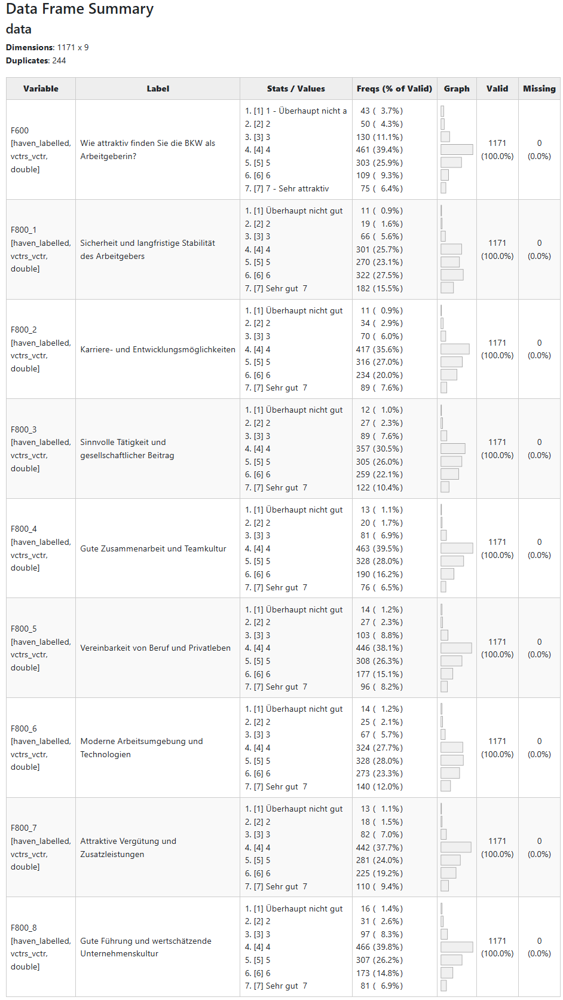
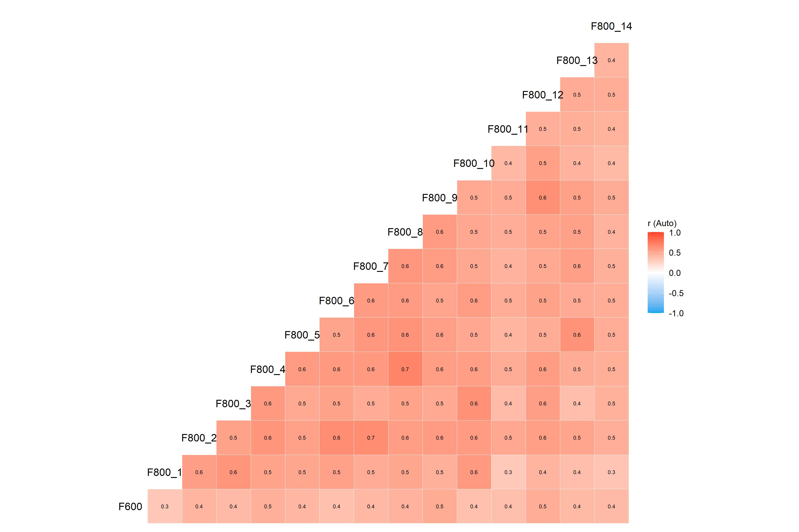
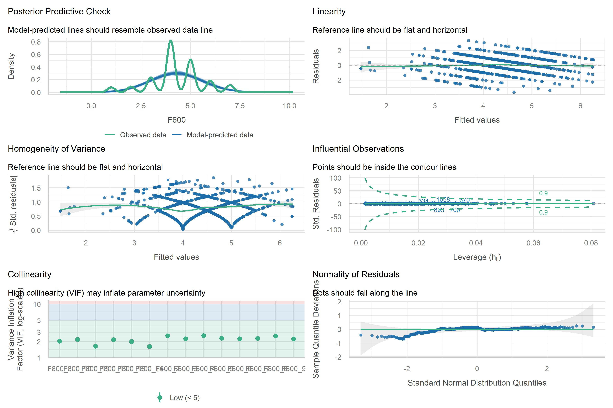
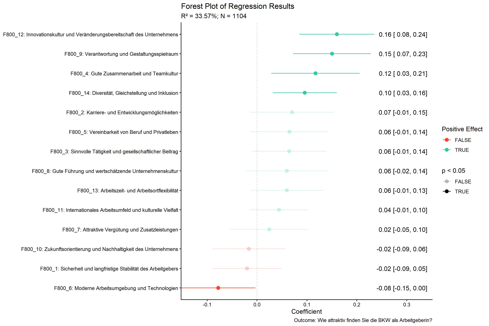
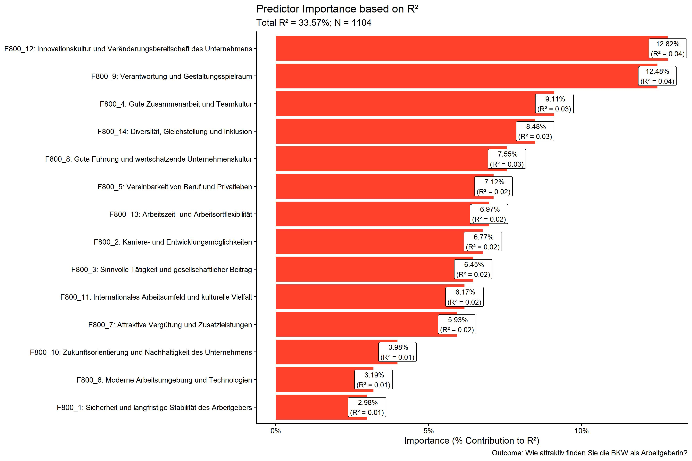
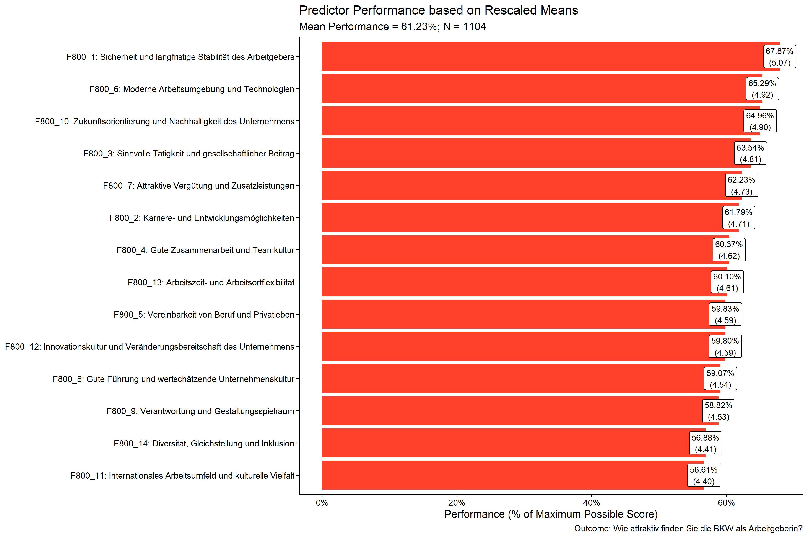
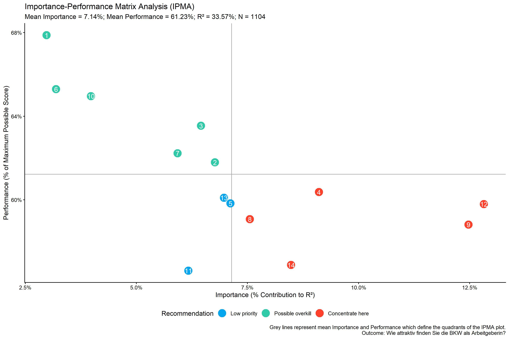

<!-- README.md is generated from README.Rmd. Please edit that file -->

```{r, include = FALSE}
knitr::opts_chunk$set(
  collapse = TRUE,
  comment = "#>",
  fig.path = "man/figures/README-",
  out.width = "100%"
)
```

# YouAnalyser <a href="https://eguizarrosales.github.io/YouAnalyser/"></a>


<!-- badges: start -->
<!-- badges: end -->

The goal of YouAnalyser is to provide Analytics Partners of YouGov DACH with a convenient and standardized way to perform core analyses on survey data, such as Key Driver Analysis (KDA). The package includes functions for data preprocessing, exploratory data analysis (EDA), Key Driver Analysis (KDA), Price Sensitivity Meter analysis (PSM), and segmentation (cluster analysis, SEG), all designed to work seamlessly with survey data in the `haven::labelled()` format. By using YouAnalyser, you can save time and ensure consistency in your analyses across different projects.

## Installation and Setup

You can install the development version of YouAnalyser from [GitHub](https://github.com/EGuizarRosales/YouAnalyser) with:

``` r
# install.packages("remotes")
remotes::install_github(
  "EGuizarRosales/YouAnalyser",
  dependencies = TRUE,
  build_vignettes = TRUE
)
```

`build_vignettes = TRUE` builds the vignettes during the installation, so that they are available offline with `vignette()` and `browseVignettes()`. `dependencies = TRUE` also installs the suggested packages that the vignettes need. Building the vignettes takes a few minutes (mainly the segmentation vignette). If you do not need them locally, set `build_vignettes = FALSE` and read the vignettes on the [website](https://eguizarrosales.github.io/YouAnalyser/) instead.

Then, in your scripts, use:

```{r load-libraries}
library(YouAnalyser)
library(haven)
```

**Some general Tips:**

* You can find the documentation for each function by calling `?function_name` in your R console (e.g., `?eda_summary`).
* This package is documented with vignettes. If you installed it with `build_vignettes = TRUE` (see above), you can browse the available vignettes with `browseVignettes("YouAnalyser")` and open a specific vignette with `vignette("vignette_name", package = "YouAnalyser")`.
* The most convenient way to access the full documentation of this package is through the website: <https://eguizarrosales.github.io/YouAnalyser/>.

## 1. Data Processing, Convenience Functions, and Example Data

All data processing functions start with the prefix `dp_`, while convenience functions start with the prefix `ya_`. For a detailed walkthrough of the data processing functions, please refer to the vignette included in the package (use e.g. `vignette("dp", package = "YouAnalyser")`), which provide step-by-step guides on how to use the various functions for data processing and other convenient tasks.

`YouAnalyser` assumes that your data comes in the `haven::labelled()` format, which is common for survey data. The package includes functions to help you process and prepare your data for analysis if your data is not already in this format:

* `dp_copy_codebook_template()`: Copy a codebook template to a specified file path
* `dp_convert_to_labelled()`: Convert a data frame to a labelled data frame using a codebook.
* `dp_label_automatically()`: Automatically label a data frame based on its values (useful for filling in missing labels if you do not want to use `dp_convert_to_labelled()` with a codebook - use with caution!)
* `dp_inspect_codebook()`: Inspect the codebook of a labelled data frame (useful to check whether labelling worked as expected)
* `dp_zap_missings()`: Remove missing values and their value labels from a labelled data frame.

The convenience functions starting with `ya_` mostly take care of selecting files, defining file names, and saving plots:

* `ya_choose_file()`: Choose an existing file and return its path
* `ya_choose_file_path()`: Choose an existing directory and define a new file in this directory, returning the full file path
* `ya_save_plot()`: Save a plot to JPEG

Special consideration should be given to `ya_setup_folder_structure()`, which creates a standardized folder structure for your project. This function is designed to help you organize your files and outputs in a consistent way across different projects. By default, it creates the following folder structure:

``` text
├── 01_input
│   └── data
│       ├── processed
│       └── raw
├── 02_scripts
├── 03_output
│   ├── data
│   ├── plots
│   └── reports
```

With `make_rproj = TRUE`, the folder is also set up as an RStudio project. With `template`, a template script for an analysis is copied into `02_scripts`: `"kda"` for a Key Driver Analysis (see `vignette("kda", package = "YouAnalyser")`) or `"seg"` for a segmentation (see `vignette("seg", package = "YouAnalyser")`), e.g. `ya_setup_folder_structure("mySegmentation", template = "seg")`.

## 2. Exploratory Data Analysis (EDA)

All EDA functions start with the prefix `eda_`. For a detailed walkthrough of the EDA functions, please refer to the vignettes included in the package (use e.g. `vignette("eda", package = "YouAnalyser")`), which provide step-by-step guides on how to use the various functions for EDA.

There are two basic functions for EDA in the YouAnalyser package: `eda_summary()` and `eda_correlation()`. The former provides a summary of the data, including descriptive statistics and missing values, while the latter calculates and visualizes correlations between variables.

```{r eda_summary-example}
eda_summary(
  data = bkw_processed,
  variables = c("F600", paste0("F800_", 1:8)),
  console_output = TRUE,
  browser_output = FALSE
)
```

By setting `browser_output = TRUE`, the output will be displayed in your default web browser, which can be more convenient for exploring large tables and visualizations. The result will look like this:



You can request a correlation matrix for a set of variables using the `eda_correlation()` function:

```{r eda_correlation-example, fig.width = 12, fig.height = 12, out.width = "100%"}
eda_corrs <- eda_correlation(
  data = bkw_processed,
  variables = c("F600", paste0("F800_", 1:8)),
  correlation_type = "Pearson"
)
print(eda_corrs$d)
print(eda_corrs$p)
```

There are many more options for `correlation_type`. To see all available options, call `?correlation::correlation` and read the details section.

## 3. Key Driver Analysis (KDA)

All KDA functions start with the prefix `kda_`. For a detailed walkthrough of the KDA functions, please refer to the vignettes included in the package (use e.g. `vignette("kda", package = "YouAnalyser")`), which provide step-by-step guides on how to use the various functions for KDA.

This is a basic example which shows you how to conduct a End-2-End Key Driver Analysis using the YouAnalyser package. For a more detailed walkthrough, please refer to the vignettes included in the package (use e.g. `vignette("kda", package = "YouAnalyser")`), which provide step-by-step guides on how to use the various functions for KDA.

```{r kda_regression_example}
res <- kda_regression(
  data = bkw_processed,
  outcome = "F600",
  predictors = paste0("F800_", 1:8),
  diagnostics = TRUE,
  importance_method = "auto"
)
```

`res` is a list containing the results of the KDA, including the fitted regression model, variable importance and performance measures, and plots. The most important outcome is the "Importance Performance Map Analysis" (IPMA) plot, which can be accessed like this:

```{r res_plots_ipma_p, fig.width = 12, fig.height = 10, out.width = "100%", eval = FALSE}
res$plots$ipma_scatterPlot$p
```

Below you can find all the available plots in the `res` object. You can save these plots using the `ya_save_plot()` function, which allows you to specify the file path and dimensions of the saved plot.
```{r save_available_kda_plots, include = FALSE, eval = FALSE}
purrr::iwalk(
  .x = res$plots,
  .f = \(x, name) {
    ya_save_plot(
      plot = x$p,
      file_path = paste0(
        "./man/figures/",
        name,
        ".jpeg"
      ),
      width = 30,
      height = 20,
      verbose = FALSE
    )
  }
)
```

`res$plots$diagnostics_correlation`



`res$plots$diagnostics_model`



`res$plots$model_forestPlot$p`



`res$plots$importance_barPlot$p`



`res$plots$performance_barPlot$p`



`res$plots$ipma_scatterPlot$p`



## 4. Price Sensitivity Meter (PSM)

All PSM functions start with the prefix `psm_`. They perform a Van Westendorp Price Sensitivity Meter analysis, including the Newton-Miller-Smith (NMS) extension, and export the results into standardized reporting templates. For a detailed walkthrough, please refer to `vignette("psm", package = "YouAnalyser")`.

* `psm_analysis()` and `psm_analysis_weighted()`: Run the (unweighted or weighted) Van Westendorp analysis (re-exported from the `pricesensitivitymeter` package).
* `psm_design_for_weighted()`: Build the survey design for `psm_analysis_weighted()` from a weight variable.
* `psm_plot()`: Plot the price sensitivity curves with the price points and the acceptable price range, plus reach and revenue plots for the NMS extension.
* `psm_save_data_for_chart()` and `psm_copy_pptx_template()`: Export the results to the Excel and PowerPoint templates.

## 5. Segmentation (SEG)

All segmentation functions start with the prefix `seg_`. They cover a complete segmentation (cluster analysis) of survey data. For a detailed walkthrough, including the interpretation of all metrics, please refer to `vignette("seg", package = "YouAnalyser")`. A template script for a segmentation project is available with `ya_setup_folder_structure(template = "seg")`.

* `seg_prep_data()`: Prepare the clustering variables (missing values, rescaling) and compute the distance matrix.
* `seg_clustering_tendency()`: Check whether the data contains meaningful clusters at all.
* `seg_optimal_clusters()`: Suggest the number of clusters (elbow method, silhouette, gap statistic, NbClust).
* `seg_compare_algorithms()`: Compare clustering algorithms and numbers of clusters.
* `seg_cluster()`: Run the cluster analysis (hierarchical k-means by default, and many other algorithms) with standardized results and plots.
* `seg_validation()` and `seg_agreement()`: Validate the solutions with internal and external measures, and compare the solutions of different algorithms.
* `seg_plot_centers()`: Plot the profiles of the clusters.
* `predict()`: Assign new respondents (e.g. of a new wave) to the clusters.

The clusters can then be described in detail with the `eda_` functions, most conveniently with the interactive app `eda_explore()`.
