# 5. Segmentation (Cluster Analysis)

``` r

library(YouAnalyser)
library(dplyr)
```

## Introduction

A **segmentation** divides respondents into groups (*segments* or
*clusters*) such that respondents within a segment are as similar as
possible and respondents in different segments are as different as
possible. In market research, segments are typically built on attitudes,
needs or behaviours (the *clustering variables*) and then described with
further variables such as sociodemographics or media usage (the
*profiling variables*).

**Cluster analysis** is the family of statistical methods that finds
such groups. Unlike regression, there is no outcome variable that tells
us what the “right” answer is: the algorithm only sees the clustering
variables and searches for groups of similar respondents. This has an
important consequence: *a clustering algorithm always returns clusters,
even if the data does not contain any groups at all.* A large part of a
good segmentation is therefore not the clustering itself, but checking
whether the clusters are real, how many there are and how well they are
separated.

The segmentation functions of YouAnalyser all start with `seg_` and
follow the steps of this vignette:

| Step | Question | Functions |
|----|----|----|
| 1\. Data preparation | Which variables, how to handle missing values and different scales? | [`seg_prep_data()`](https://eguizarrosales.github.io/YouAnalyser/reference/seg_prep_data.md), [`seg_distance()`](https://eguizarrosales.github.io/YouAnalyser/reference/seg_distance.md) |
| 2\. Clustering tendency | Does the data contain clusters at all? | [`seg_clustering_tendency()`](https://eguizarrosales.github.io/YouAnalyser/reference/seg_clustering_tendency.md) |
| 3\. Optimal number of clusters | How many clusters are there? | [`seg_optimal_clusters()`](https://eguizarrosales.github.io/YouAnalyser/reference/seg_optimal_clusters.md), `seg_nbclust_*()` |
| 4\. Clustering | Which respondent belongs to which cluster? | [`seg_cluster()`](https://eguizarrosales.github.io/YouAnalyser/reference/seg_cluster.md), `seg_cluster_*()`, [`seg_compare_algorithms()`](https://eguizarrosales.github.io/YouAnalyser/reference/seg_compare_algorithms.md) |
| 5\. Cluster validation | How good is the solution? | [`seg_validation()`](https://eguizarrosales.github.io/YouAnalyser/reference/seg_validation.md), [`seg_plot_silhouette()`](https://eguizarrosales.github.io/YouAnalyser/reference/seg_plot_silhouette.md), [`seg_agreement()`](https://eguizarrosales.github.io/YouAnalyser/reference/seg_agreement.md) |
| 6\. Cluster interpretation | What characterizes the clusters? | [`eda_explore()`](https://eguizarrosales.github.io/YouAnalyser/reference/eda_explore.md), [`eda_plot()`](https://eguizarrosales.github.io/YouAnalyser/reference/eda_plot.md), [`eda_describe()`](https://eguizarrosales.github.io/YouAnalyser/reference/eda_describe.md), [`eda_test()`](https://eguizarrosales.github.io/YouAnalyser/reference/eda_test.md) |
| 7\. Assigning new respondents | To which cluster does a new respondent belong? | [`predict()`](https://rdrr.io/r/stats/predict.html) |

The methodology closely follows the excellent tutorials on
[datanovia](https://www.datanovia.com/learn/machine-learning/clustering)
and the book by Kassambara (2017), and builds on the R packages
factoextra, cluster, NbClust, clValid and fpc. The documentation of each
function
(e.g. [`?seg_validation`](https://eguizarrosales.github.io/YouAnalyser/reference/seg_validation.md))
contains more details, formulas and references.

**Getting started with your own project:**
`ya_setup_folder_structure("mySegmentation", template = "seg")` creates
a project folder with a template script (`02_scripts/seg.R`) that
follows the steps of this vignette with the recommended settings
(hierarchical k-means), from the data preparation to the export of the
segments.

### Example data

We use two datasets throughout this vignette:

- **`sm_synthetic`**: synthetic data based on a real study about
  nutrition (Swissmilk “Milch & Umwelt” 2024). 1,401 respondents rated
  20 attitude statements towards nutrition (`F50_0_1` to `F50_0_20`,
  scale 1 = “Stimme überhaupt nicht zu” to 10 = “Stimme voll und ganz
  zu”). The original study used these items to define four nutrition
  types (`cluster_benchmark`). This is what typical survey data looks
  like: the cluster structure is **weak**.
- **`sim_segments`**: simulated data of 600 respondents on 20 rating
  items (1-10), generated from three clearly different segments of 200
  respondents each (see
  [`?sim_segments`](https://eguizarrosales.github.io/YouAnalyser/reference/sim_segments.md)).
  The true segment is stored in `segment`. This data has a **clear**
  cluster structure and shows what the results look like when there
  really are clusters.

Comparing both datasets at every step helps to develop an intuition for
what “good” and “weak” results look like.

## 1. Data preparation

Clustering algorithms group respondents by their **distance**: two
respondents are close if they gave similar answers on the clustering
variables. Before computing distances, three decisions have to be made,
all of which are handled by
[`seg_prep_data()`](https://eguizarrosales.github.io/YouAnalyser/reference/seg_prep_data.md):

1.  **Clustering variables** (`vars`): Only include variables that are
    relevant for the purpose of the segmentation. Every variable
    included influences the result, and variables that do not differ
    between segments only add noise. Variables that are highly redundant
    (e.g. several items measuring the same thing) give that aspect more
    weight.
2.  **Missing values** (`missing`): Distances cannot be computed with
    missing values, so they are either removed (`"omit"`, listwise
    deletion), replaced (`"mean"`, `"median"`, or a model-based
    imputation with `"mice"`), or kept with the Gower distance
    (`"none"`). User-defined missing values such as 99 = “don’t know”
    must be recoded to `NA` first, e.g. with
    [`dp_recode_missing()`](https://eguizarrosales.github.io/YouAnalyser/reference/dp_recode_missing.md).
3.  **Scaling** (`scale`): Variables with a large spread dominate the
    distance. By default, all variables are z-standardized (mean 0,
    standard deviation 1), so that each variable gets the same weight.

Finally,
[`seg_prep_data()`](https://eguizarrosales.github.io/YouAnalyser/reference/seg_prep_data.md)
computes the **distance matrix** (`distance`, default: Euclidean
distance, the straight-line distance between the answer profiles of two
respondents). See
[`?seg_prep_data`](https://eguizarrosales.github.io/YouAnalyser/reference/seg_prep_data.md)
for a description of all distance measures and when to use them.

In `sm_synthetic`, the “weiss nicht / keine Angabe” answers are already
recoded to `NA`. We use **mean imputation**, i.e. each missing value is
replaced by the mean of the respective item:

``` r

prep <- seg_prep_data(
  sm_synthetic,
  vars = starts_with("F50_0_"),
  id = "id",
  missing = "mean"
)
#> 
#> ── Data prepared for cluster analysis ──
#> 
#> • Clustering variables: 20
#> • Respondents: 1401 in, 1400 retained
#> • Without any valid answer: 1 respondent removed
#> • Missing threshold: not applied
#> • Missing values: "mean" (0 respondents removed, 778 values imputed)
#> • Scaling: "z"
#> • Distance: euclidean (get_dist)
```

The summary shows that one respondent without any valid answer was
removed and that 778 values were imputed. This corresponds to 2.8% of
all answers.

**How to choose the missing value strategy?** Mean imputation is simple
and keeps all respondents, but it pulls imputed respondents towards the
“average respondent” and reduces the variance of the items. As a rule of
thumb, this is unproblematic if only a small share of the values is
missing, often given as less than 5% (Schafer, 1999). With more missing
values, prefer `missing = "mice"`, which imputes values based on the
respondent’s other answers, and combine it with `max_missing_prop`
(e.g. `0.2`) to remove respondents who answered only a few items.

The result is a list with the prepared data (`prep$data`, the
standardized clustering variables), the original data of the retained
respondents (`prep$data_full`, used later to describe the clusters) and
the distance matrix (`prep$dist`):

``` r

prep$data
#> # A tibble: 1,400 × 20
#>    F50_0_1 F50_0_2 F50_0_3 F50_0_4 F50_0_5 F50_0_6 F50_0_7 F50_0_8 F50_0_9
#>      <dbl>   <dbl>   <dbl>   <dbl>   <dbl>   <dbl>   <dbl>   <dbl>   <dbl>
#>  1  0.517    0.243  -1.12   1.30     1.82    1.16    1.29    0.554   0.295
#>  2 -0.431    0.729  -0.170 -0.0927  -1.14    0.732   0.174   0.179   0.295
#>  3 -1.85     0.243  -0.170 -1.48     2.67    0.302  -3.16   -0.949  -0.154
#>  4 -2.33     0.243   0.778 -1.48     0.553   1.16   -1.49    0.179  -1.05 
#>  5  0.0433  -0.729  -0.644 -1.02    -0.719   1.16    0.730   0.554  -1.05 
#>  6 -0.431    0.243  -0.644 -0.0927   0.976   0.302  -0.937  -0.197  -1.05 
#>  7  1.47    -0.729   1.25   1.30    -1.14   -1.42    1.29    0.554  -2.40 
#>  8  0.517   -0.729   0.304  0.835   -1.14   -0.557  -1.49   -1.70    1.19 
#>  9  0.517   -0.729   0.304  0.371   -1.14    0.302   0.174   0.179  -0.603
#> 10 -1.85    -1.22    0.304 -1.95     2.25    0.732  -0.382  -0.949   1.19 
#> # ℹ 1,390 more rows
#> # ℹ 11 more variables: F50_0_10 <dbl>, F50_0_11 <dbl>, F50_0_12 <dbl>,
#> #   F50_0_13 <dbl>, F50_0_14 <dbl>, F50_0_15 <dbl>, F50_0_16 <dbl>,
#> #   F50_0_17 <dbl>, F50_0_18 <dbl>, F50_0_19 <dbl>, F50_0_20 <dbl>
```

We prepare `sim_segments` in the same way (it has no missing values):

``` r

prep_sim <- seg_prep_data(
  sim_segments,
  vars = starts_with("item_"),
  id = "id",
  verbose = FALSE
)
```

## 2. Clustering tendency

Because clustering algorithms always find clusters, the first question
is whether the data contains any cluster structure at all.
[`seg_clustering_tendency()`](https://eguizarrosales.github.io/YouAnalyser/reference/seg_clustering_tendency.md)
compares the actual data with a **random dataset** of the same size, in
which each variable is drawn from a uniform distribution within the
range of the actual variable. Random data has no clusters by
construction, so it shows what “no structure” looks like.

Two tools are used:

- **Hopkins statistic** (Hopkins & Skellam, 1954; corrected version by
  Wright, 2022). It compares the distance of real respondents to their
  nearest neighbour with the distance of random points to their nearest
  real respondent. If the data is clustered, real respondents have close
  neighbours (inside their cluster), while random points often fall into
  “empty” space between clusters.
- **VAT plot** (Visual Assessment of cluster Tendency; Bezdek &
  Hathaway, 2002). The distance matrix is shown as an image, with the
  respondents ordered so that similar respondents are next to each
  other. Small distances are shown in red, large distances in blue.
  Clusters appear as **red squares along the diagonal**.

| Hopkins statistic | Interpretation |
|----|----|
| around 0.5 | the data looks like random (uniformly distributed) data, no clustering tendency |
| \> 0.75 | clear clustering tendency (Lawson & Jurs, 1990) |
| close to 1 | strong clustering tendency |

### Example with a clear structure: `sim_segments`

``` r

tendency_sim <- seg_clustering_tendency(prep_sim)
#> 
#> ── Clustering tendency ──
#> 
#> • Hopkins statistic, actual data: 1.000
#> • Hopkins statistic, random data: 0.465
#> • Interpretation: data clearly deviates from random data
#> Values close to 0.5 indicate random data, values close to 1 a clustering
#> tendency. With many correlated variables, Hopkins is often close to 1 even
#> without well separated clusters: check whether the VAT plot in `$plot` shows
#> squares along the diagonal.
tendency_sim$plot
```

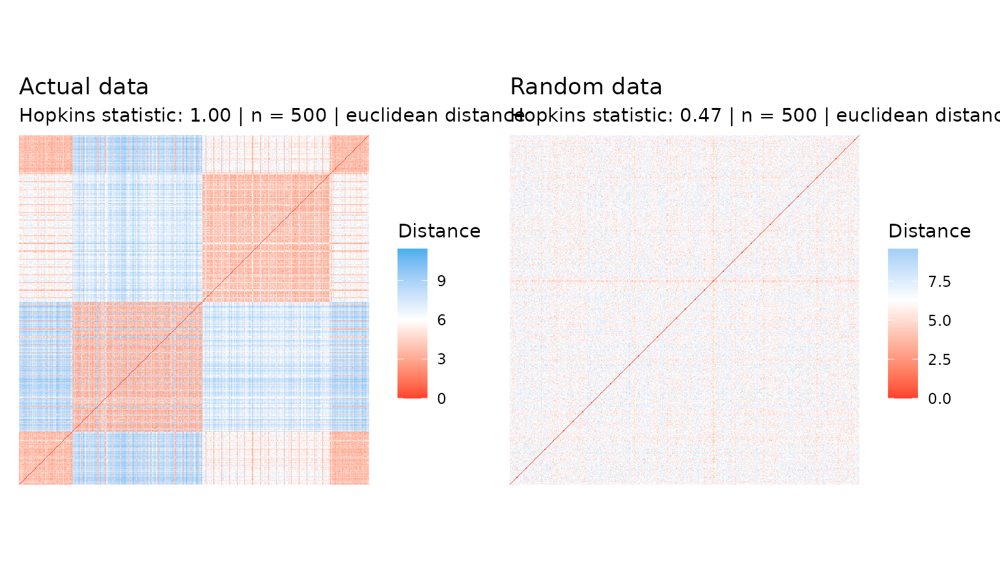

The Hopkins statistic of the actual data (1) is far above the one of the
random data (0.47, close to the expected 0.5). The VAT plot of the
actual data shows three clear red squares along the diagonal, which
correspond to the three simulated segments. The VAT plot of the random
data shows no such structure.

### Example with real survey data: `sm_synthetic`

``` r

tendency <- seg_clustering_tendency(prep)
#> 
#> ── Clustering tendency ──
#> 
#> • Hopkins statistic, actual data: 0.983
#> • Hopkins statistic, random data: 0.489
#> • Interpretation: data clearly deviates from random data
#> Values close to 0.5 indicate random data, values close to 1 a clustering
#> tendency. With many correlated variables, Hopkins is often close to 1 even
#> without well separated clusters: check whether the VAT plot in `$plot` shows
#> squares along the diagonal.
tendency$plot
```

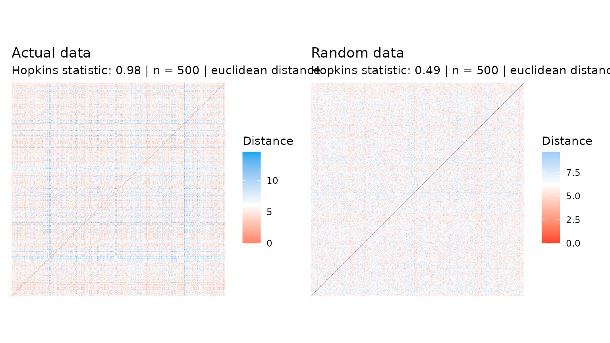

The Hopkins statistic (0.98) is again far above the threshold of 0.75.
However, the VAT plot looks very different from the one of
`sim_segments`: there are no clearly delimited squares, only a gradual
transition from red to blue.

This illustrates an important limitation of the Hopkins statistic: it
measures whether the data deviates from *uniformly distributed* data,
not whether it contains *well separated groups*. Survey data with many
correlated rating scales is never uniformly distributed (answers
concentrate in certain regions, e.g. many respondents agree with several
related statements), so the Hopkins statistic is almost always close
to 1. **Always look at the VAT plot as well.** If it shows no clear
squares, as here, the segments that we will find are not “natural”
groups, but a useful way to divide a continuum of respondents into
types. This is very common in market research and does not mean that the
segmentation is useless, but it should be communicated accordingly
(e.g. “respondents can be described by four types” rather than “there
are four distinct groups”).

## 3. Optimal number of clusters

Most clustering algorithms need the number of clusters *k* as input.
[`seg_optimal_clusters()`](https://eguizarrosales.github.io/YouAnalyser/reference/seg_optimal_clusters.md)
runs four common methods to suggest *k* (Kassambara, 2017). All of them
cluster the data for *k* = 1 (or 2) to 10 and evaluate each solution:

- **Elbow method (WSS)** (Thorndike, 1953): The total *within-cluster
  sum of squares* (WSS) measures how compact the clusters are, i.e. how
  far respondents are from the centre of their cluster. WSS always
  decreases with more clusters, so its minimum is meaningless. Instead,
  look for the **“elbow”**: the *k* after which additional clusters only
  bring small improvements.
- **Average silhouette width** (Rousseeuw, 1987): For each respondent,
  the silhouette width compares the average distance to the members of
  its own cluster with the average distance to the members of the
  nearest other cluster. It ranges from -1 to 1; high values mean that
  respondents are much closer to their own cluster than to the next one.
  The optimal *k* **maximizes** the average silhouette width. It is
  explained in more detail in [Section 5](#cluster-validation).
- **Gap statistic** (Tibshirani et al., 2001): Compares the WSS of the
  data with the WSS expected for random data without clusters (as in
  Section 2). The *gap* is large when the clusters are much more compact
  than in random data. The optimal *k* is the smallest *k* whose gap is
  within one standard error of the first local maximum. In contrast to
  the silhouette, the gap statistic can also suggest *k* = 1, i.e. no
  clusters.
- **NbClust** (Charrad et al., 2014): Computes up to 26 different
  indices proposed in the literature (e.g. the Calinski-Harabasz index
  or the Davies-Bouldin index), each of which proposes its own best *k*.
  The optimal *k* is the one **proposed by most indices** (majority
  vote).

### Example with a clear structure: `sim_segments`

``` r

optimal_sim <- seg_optimal_clusters(prep_sim, verbose = FALSE)
optimal_sim
optimal_sim$plot
```

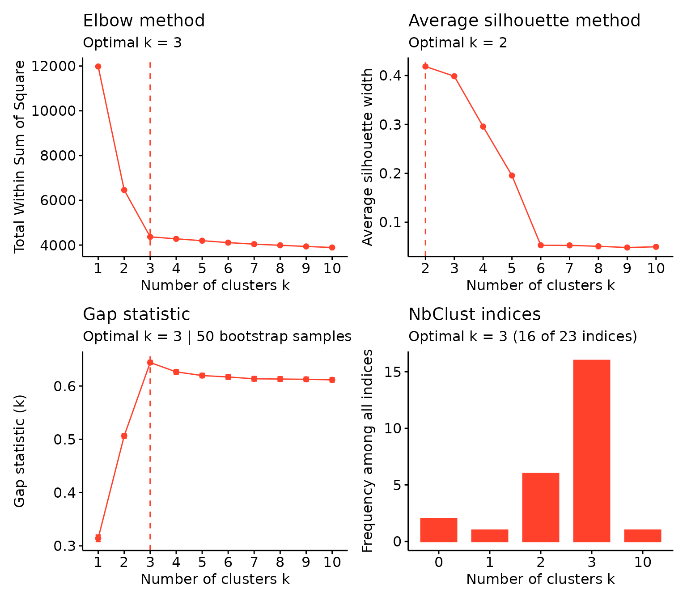

With a clear cluster structure, the methods largely agree: the WSS curve
shows a sharp elbow at *k* = 3 (from *k* = 3 onwards, adding clusters
hardly reduces the WSS), the gap statistic and the majority of the
NbClust indices also suggest *k* = 3.

The average silhouette width suggests *k* = 2, with *k* = 3 as a close
second. This is a known tendency of the silhouette: it often favours few
clusters, because merging two clusters can increase the distance to the
nearest *other* cluster. Always look at the whole curve, and not only at
its maximum.

### Example with real survey data: `sm_synthetic`

``` r

optimal <- seg_optimal_clusters(prep, verbose = FALSE)
optimal
optimal$plot
```

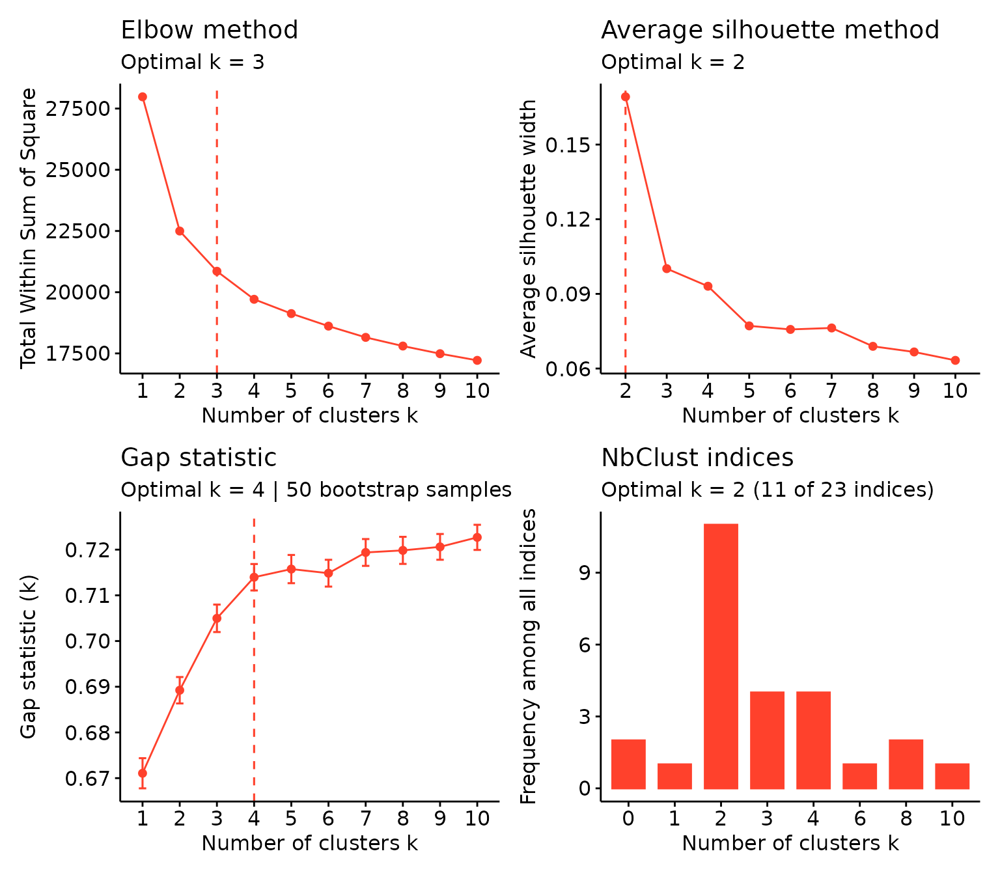

With the weak structure of `sm_synthetic`, the methods disagree: the
silhouette and NbClust favour *k* = 2, the elbow method *k* = 3 and the
gap statistic *k* = 4. The plots also look different from
`sim_segments`: the WSS curve bends only gradually (the automatically
determined elbow at *k* = 3 is a weak one), the silhouette is low for
every *k*, the gap statistic keeps increasing slowly after *k* = 4
instead of showing a clear peak, and the NbClust votes are spread over
several values of *k*. All of these are signs that the data has no
natural number of clusters.

This is the normal case in market research. The methods then do not
provide *the* answer, but a range of **candidate solutions** (here *k* =
2 to 4). The final choice also depends on:

- **Interpretability**: Can each segment be described and named in a
  meaningful way?
- **Usefulness**: Does the solution answer the business question? Two
  segments are often too coarse (e.g. respondents who agree more
  vs. agree less with all statements), while too many segments are hard
  to communicate and act on.
- **Segment sizes**: Very small segments are hard to target and their
  profiles are unreliable. YouAnalyser flags solutions whose smallest
  segment is below 5% of the respondents (`min_cluster_share`).
- **Validation** (see Section 5): How compact, separated and stable are
  the candidate solutions?

Dolnicar et al. (2018) give a detailed overview of criteria for
selecting market segments. In the following, we continue with *k* = 4,
which is suggested by the gap statistic, is the second most supported
solution of NbClust (together with *k* = 3), and corresponds to the four
nutrition types of the original study.

**Computation time:** The gap statistic and NbClust are slow (together
about one minute for `sm_synthetic`). For a quick first look, use
`methods = c("wss", "silhouette")`. The individual methods are also
available as
[`seg_nbclust_wss()`](https://eguizarrosales.github.io/YouAnalyser/reference/seg_nbclust_wss.md),
[`seg_nbclust_silhouette()`](https://eguizarrosales.github.io/YouAnalyser/reference/seg_nbclust_silhouette.md),
[`seg_nbclust_gap()`](https://eguizarrosales.github.io/YouAnalyser/reference/seg_nbclust_gap.md)
and
[`seg_nbclust_indices()`](https://eguizarrosales.github.io/YouAnalyser/reference/seg_nbclust_indices.md).

## 4. Clustering

[`seg_cluster()`](https://eguizarrosales.github.io/YouAnalyser/reference/seg_cluster.md)
runs the cluster analysis. It supports many algorithms (`method`), which
are compared in
[`?seg_cluster`](https://eguizarrosales.github.io/YouAnalyser/reference/seg_cluster.md).
For typical survey segmentations based on rating scales, we recommend
**hierarchical k-means** (`method = "hkmeans"`, the default), which
combines the two most common approaches:

- **k-means** (MacQueen, 1967; Hartigan & Wong, 1979) describes each
  cluster by its centre (the mean of its members). Starting from *k*
  initial centres, it alternates between assigning each respondent to
  the nearest centre and recomputing each centre as the mean of its
  members, until the assignment no longer changes. The result is a set
  of compact clusters with a small WSS. Its weakness: the result depends
  on the randomly chosen initial centres.
- **Hierarchical clustering** with Ward’s method (Ward, 1963) starts
  with each respondent as its own cluster and successively merges the
  two clusters whose merger increases the WSS the least, until all
  respondents are in one cluster. The result is a tree (*dendrogram*)
  that can be cut into any number of clusters. Its weakness: once
  merged, respondents cannot change their cluster, even if they would
  fit better elsewhere.

**Hierarchical k-means** (Kassambara, 2017) first runs the hierarchical
clustering, cuts the tree into *k* clusters, and uses the centres of
these clusters as starting centres for k-means, which then optimizes the
assignment. The result is deterministic (no random starts) and combines
the global view of the hierarchical clustering with the optimization of
k-means.

### Example with a clear structure: `sim_segments`

``` r

cl_sim <- seg_cluster(prep_sim, k = 3)
#> 
#> ── Cluster solution: Hierarchical k-means, k = 3 ──
#> 
#> • Cluster 1: n = 200 (33%)
#> • Cluster 2: n = 200 (33%)
#> • Cluster 3: n = 200 (33%)
#> Plots: `$plots$cluster`, `$plots$dend`, `$plots$heatmap`, and `$plots$centers`
```

The clusters are numbered by size (1 = largest cluster). Since the true
segments are known, we can check whether the clustering recovered them:

``` r

table(cluster = cl_sim$cluster, segment = cl_sim$data_full$segment)
#>        segment
#> cluster   1   2   3
#>       1 200   0   0
#>       2   0   0 200
#>       3   0 200   0
```

Each cluster contains exactly the respondents of one simulated segment:
the clustering recovered the segments perfectly (the cluster numbers are
arbitrary and do not need to match the segment numbers).

Every solution comes with four plots (hierarchical methods and
hierarchical k-means also with a dendrogram). The **cluster plot** shows
the respondents in the space of the first two principal components,
i.e. the two dimensions that summarize most of the differences between
respondents:

``` r

cl_sim$plots$cluster
```

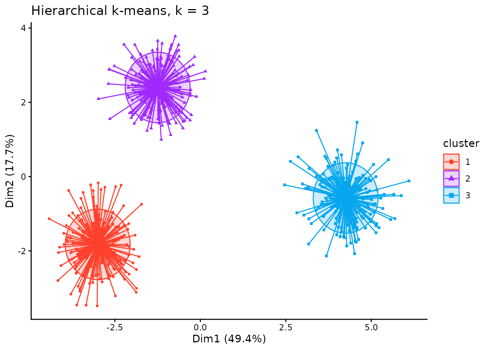

The **heatmap** shows the (standardized) answers of a random sample of
respondents (rows), grouped by cluster, on all clustering variables
(columns). Red stands for above-average and blue for below-average
answers. With a clear structure, each cluster forms a block with its own
pattern: here, each segment agrees with its “own” block of items.

``` r

cl_sim$plots$heatmap
```

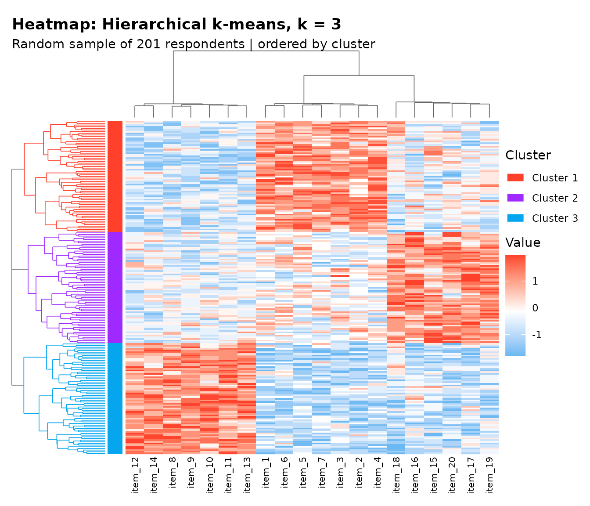

The **cluster profiles** summarize each cluster by its centre, i.e. the
mean of each clustering variable in the cluster (`cl_sim$centers`), here
on the z-standardized scale with the total mean as dashed line. The
profiles show the structure of the simulated segments at a glance: each
cluster scores clearly above average on its own block of items and below
average on the others. Section 6 shows how to use this plot to interpret
and name the clusters.

``` r

cl_sim$plots$centers
```

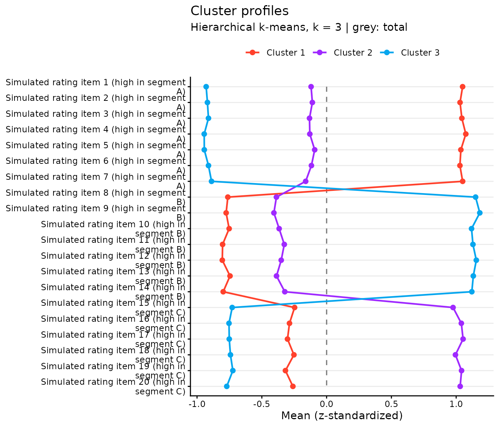

### Example with real survey data: `sm_synthetic`

``` r

cl <- seg_cluster(prep, k = 4)
#> 
#> ── Cluster solution: Hierarchical k-means, k = 4 ──
#> 
#> • Cluster 1: n = 411 (29%)
#> • Cluster 2: n = 367 (26%)
#> • Cluster 3: n = 362 (26%)
#> • Cluster 4: n = 260 (19%)
#> Plots: `$plots$cluster`, `$plots$dend`, `$plots$heatmap`, and `$plots$centers`
```

``` r

cl$plots$cluster
```

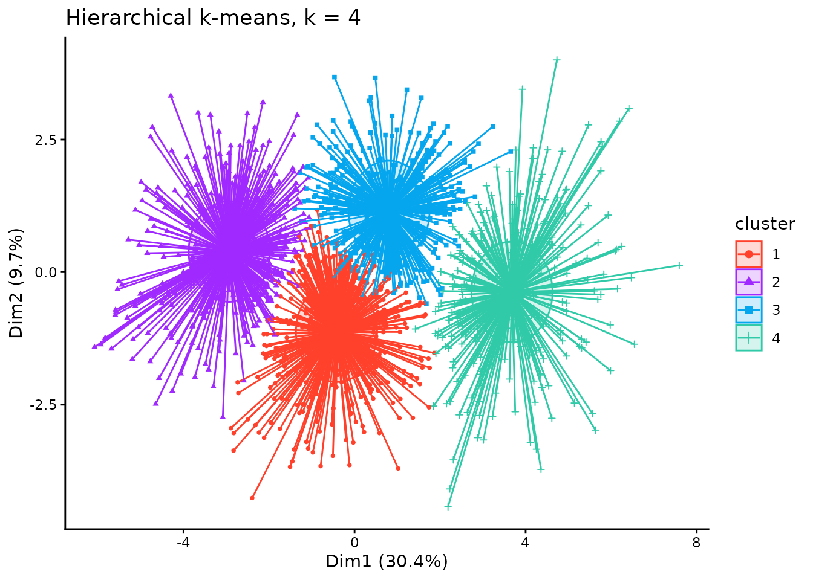

In contrast to `sim_segments`, the clusters overlap in the cluster plot
and form a continuous cloud. Keep in mind that the two principal
components only show part of the differences between respondents (see
the percentages in the axis labels), so clusters can overlap in the plot
even if they are better separated in the full 20-dimensional space.
Whether that is the case is assessed in Section 5.

``` r

cl$plots$heatmap
```

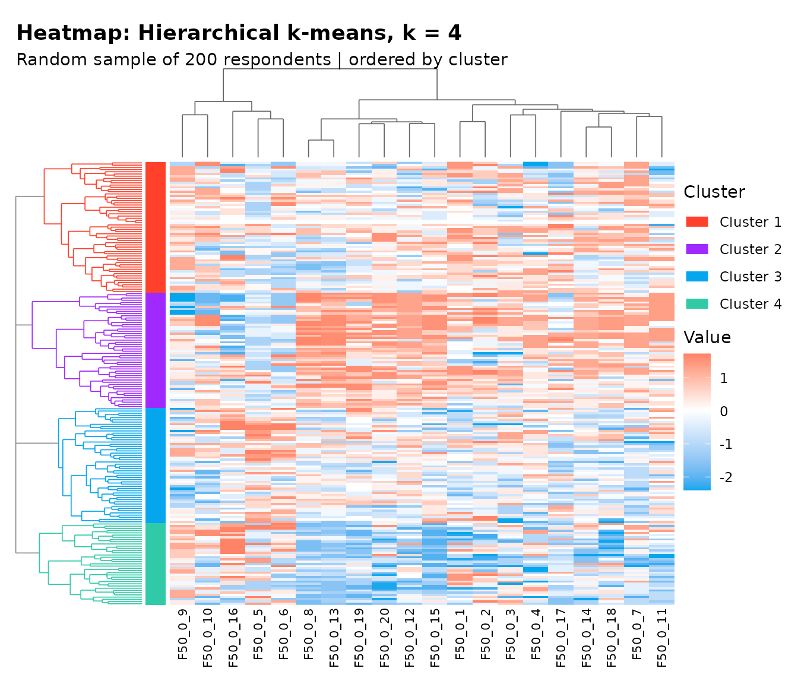

The heatmap shows patterns within the clusters as well, but they are
more blurred than in `sim_segments`: the clusters differ in their
*tendencies*, but there is considerable variation within each cluster.

The **dendrogram** shows the tree of the hierarchical step, coloured by
the final clusters. Long vertical lines before a merge indicate well
separated clusters.

``` r

cl$plots$dend
```

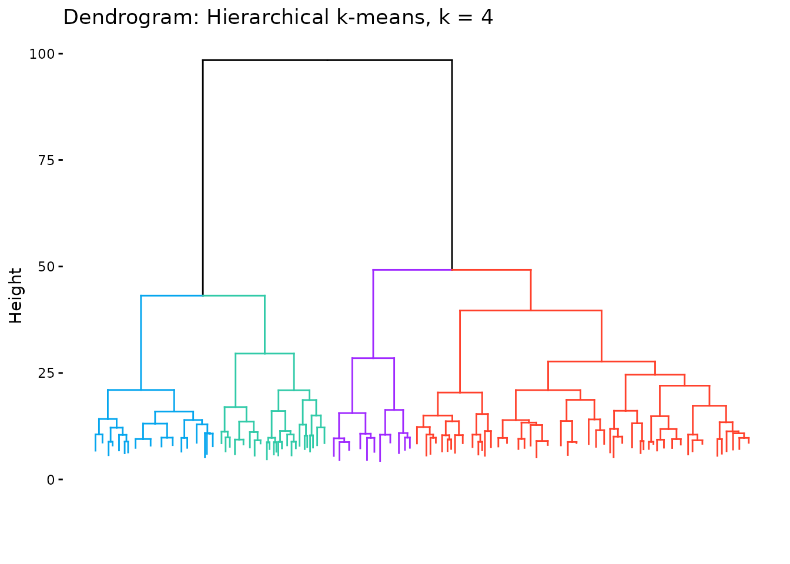

The most important results of the solution are:

``` r

cl$sizes # size and share of each cluster
#> # A tibble: 4 × 3
#>   cluster     n share
#>     <int> <int> <dbl>
#> 1       1   411 0.294
#> 2       2   367 0.262
#> 3       3   362 0.259
#> 4       4   260 0.186
cl$centers # mean of each (standardized) clustering variable per cluster
#> # A tibble: 4 × 21
#>   cluster F50_0_1 F50_0_2 F50_0_3 F50_0_4 F50_0_5 F50_0_6 F50_0_7 F50_0_8
#>     <int>   <dbl>   <dbl>   <dbl>   <dbl>   <dbl>   <dbl>   <dbl>   <dbl>
#> 1       1   0.424   0.306   0.192   0.261  -0.411  -0.256   0.453 -0.184 
#> 2       2   0.409   0.340   0.413   0.582  -0.309  -0.357   0.573  1.10  
#> 3       3  -0.438  -0.298  -0.286  -0.417   0.684   0.459  -0.606 -0.0883
#> 4       4  -0.637  -0.550  -0.488  -0.654   0.134   0.270  -0.681 -1.14  
#> # ℹ 12 more variables: F50_0_9 <dbl>, F50_0_10 <dbl>, F50_0_11 <dbl>,
#> #   F50_0_12 <dbl>, F50_0_13 <dbl>, F50_0_14 <dbl>, F50_0_15 <dbl>,
#> #   F50_0_16 <dbl>, F50_0_17 <dbl>, F50_0_18 <dbl>, F50_0_19 <dbl>,
#> #   F50_0_20 <dbl>
cl$assignment # cluster of each respondent
#> # A tibble: 1,400 × 2
#>       id cluster
#>    <dbl>   <int>
#>  1     1       1
#>  2     2       1
#>  3     3       4
#>  4     4       3
#>  5     5       3
#>  6     6       3
#>  7     7       2
#>  8     8       4
#>  9     9       1
#> 10    10       3
#> # ℹ 1,390 more rows
```

Further functions to work with cluster solutions:

- `seg_cluster(prep, k = 2:6)` computes several solutions at once
  (e.g. `cl_set$solutions$k4`), which is useful for comparing candidate
  solutions.
- [`seg_plot_cluster()`](https://eguizarrosales.github.io/YouAnalyser/reference/seg_plot_cluster.md),
  [`seg_plot_dend()`](https://eguizarrosales.github.io/YouAnalyser/reference/seg_plot_dend.md),
  [`seg_plot_heatmap()`](https://eguizarrosales.github.io/YouAnalyser/reference/seg_plot_heatmap.md)
  and
  [`seg_plot_centers()`](https://eguizarrosales.github.io/YouAnalyser/reference/seg_plot_centers.md)
  re-create the plots with other settings,
  e.g. `seg_plot_heatmap(cl, row_order = "dendrogram")`. The settings
  can also be passed when clustering,
  e.g. `seg_cluster(prep, k = 4, centers_args = list(type = "bars"))`.
- [`seg_as_cluster()`](https://eguizarrosales.github.io/YouAnalyser/reference/seg_as_cluster.md)
  converts an existing segmentation (e.g. from a previous wave) into the
  same format, so that it can be plotted, validated and profiled like a
  new solution.

### Other algorithms and `seg_compare_algorithms()`

Besides hierarchical k-means,
[`seg_cluster()`](https://eguizarrosales.github.io/YouAnalyser/reference/seg_cluster.md)
supports k-means, PAM (more robust to outliers, works with any distance
measure), hierarchical clustering (AGNES, DIANA), fuzzy clustering,
model-based clustering and density-based clustering (DBSCAN, HDBSCAN).
[`?seg_cluster`](https://eguizarrosales.github.io/YouAnalyser/reference/seg_cluster.md)
contains an overview with recommendations on when to use which method.

To get an overview of how different algorithms perform on your data,
[`seg_compare_algorithms()`](https://eguizarrosales.github.io/YouAnalyser/reference/seg_compare_algorithms.md)
runs several algorithms for several numbers of clusters and scores each
solution with the validation measures of the clValid package (Brock et
al., 2008): connectivity, silhouette width and Dunn index
(`validation = "internal"`), and optionally measures of stability when
single clustering variables are left out (`validation = "stability"`,
slow). The measures are explained in
[`?seg_compare_algorithms`](https://eguizarrosales.github.io/YouAnalyser/reference/seg_compare_algorithms.md).

``` r

algorithms <- seg_compare_algorithms(prep, cl_methods = c("hierarchical", "kmeans", "pam"), k = 2:6)
algorithms$plot
```

As with the number of clusters, the measures often disagree; use the
comparison as a screening tool and validate the most promising solutions
as described in the next section.

## 5. Cluster validation

Cluster validation answers the question: *how good is a cluster
solution?* There are three types of validation (Kassambara, 2017):

- **Internal validation** uses only the clustering variables and the
  cluster assignment. It checks whether the clusters are *compact*
  (respondents in the same cluster are similar) and *well separated*
  (respondents in different clusters are dissimilar).
- **External validation** compares the solution with a known grouping,
  e.g. the true segments of simulated data or the segmentation of a
  previous wave.
- **Relative validation** compares the internal or external measures
  across different numbers of clusters or algorithms to choose the best
  solution.

[`seg_validation()`](https://eguizarrosales.github.io/YouAnalyser/reference/seg_validation.md)
covers all three types for one or several solutions.

### Internal validation measures

**Silhouette width** (Rousseeuw, 1987). For each respondent *i*, let
*a_(i)* be the average distance to the other members of its own cluster
and *b_(i)* the average distance to the members of the nearest other
cluster (the *neighbour*). The silhouette width is

``` math
s_i = \frac{b_i - a_i}{\max(a_i, b_i)}
```

- *s_(i)* close to **1**: the respondent is much closer to its own
  cluster than to the neighbour, i.e. well clustered.
- *s_(i)* around **0**: the respondent lies between two clusters.
- *s_(i)* **negative**: the respondent is closer to the neighbour than
  to its own cluster, i.e. probably in the wrong cluster.

The average over all respondents is the **silhouette coefficient**, the
most widely used single measure of cluster quality. Kaufman and
Rousseeuw (1990) suggest the following interpretation:

| Silhouette coefficient | Interpretation                      |
|------------------------|-------------------------------------|
| \> 0.70                | strong structure                    |
| 0.51 to 0.70           | reasonable structure                |
| 0.26 to 0.50           | weak structure, could be artificial |
| ≤ 0.25                 | no substantial structure            |

These thresholds are demanding for survey data with many variables: the
more variables, the more similar the distances between all respondents
become, which lowers the silhouette. For attitudinal survey data, values
between 0.1 and 0.25 are common. Use the thresholds as an orientation,
and above all to compare solutions on the same data.

**Share of negative silhouette widths.** The share of respondents that
are probably in the wrong cluster. A few percent at the borders between
neighbouring clusters are normal; a large share, especially within a
single cluster, suggests that the cluster is not well defined (e.g. it
should be merged with its neighbour).

**Dunn index** (Dunn, 1974). The smallest distance between two
respondents in different clusters, divided by the largest distance
between two respondents in the same cluster. Higher values are better.
As it is based on a single minimum and a single maximum, it is very
sensitive to outliers. There are no general thresholds; for survey data
it is typically close to 0 and should only be used to compare solutions
on the same data.

[`seg_validation()`](https://eguizarrosales.github.io/YouAnalyser/reference/seg_validation.md)
additionally returns further statistics in `$statistics` (e.g. the
Calinski-Harabasz index, the ratio of the average within- to
between-cluster distance), which are described in
[`?seg_validation`](https://eguizarrosales.github.io/YouAnalyser/reference/seg_validation.md).

### Example with a clear structure: `sim_segments`

We validate the solutions for *k* = 2 to 5. Plots are not needed for the
cluster solutions themselves, which saves time:

``` r

cl_sim_set <- seg_cluster(prep_sim, k = 2:5, plots = FALSE, verbose = FALSE)
val_sim <- seg_validation(cl_sim_set)
#> 
#> ── Cluster validation ──
#> 
#> 4 solutions | distance: "euclidean"
#> • Hierarchical k-means, k = 2: silhouette = 0.42, Dunn = 0.490, negative
#> silhouette = 0%, smallest cluster = 33%
#> • Hierarchical k-means, k = 3: silhouette = 0.40, Dunn = 0.455, negative
#> silhouette = 0%, smallest cluster = 33%
#> • Hierarchical k-means, k = 4: silhouette = 0.25, Dunn = 0.290, negative
#> silhouette = 2%, smallest cluster = 15%
#> • Hierarchical k-means, k = 5: silhouette = 0.15, Dunn = 0.295, negative
#> silhouette = 2%, smallest cluster = 15%
#> 
#> Best solution per measure
#> • Silhouette (higher = better): Hierarchical k-means, k = 2 (0.418)
#> • Dunn (higher = better): Hierarchical k-means, k = 2 (0.490)
#> • Negative silhouette (lower = better): Hierarchical k-means, k = 2 (0.000)
#> ℹ Highest silhouette coefficient 0.42: weak cluster structure (Kaufman & Rousseeuw).
#> Plots: `$plot (measures)`, `$plot_silhouette`, and `$plots`
val_sim$plot
```

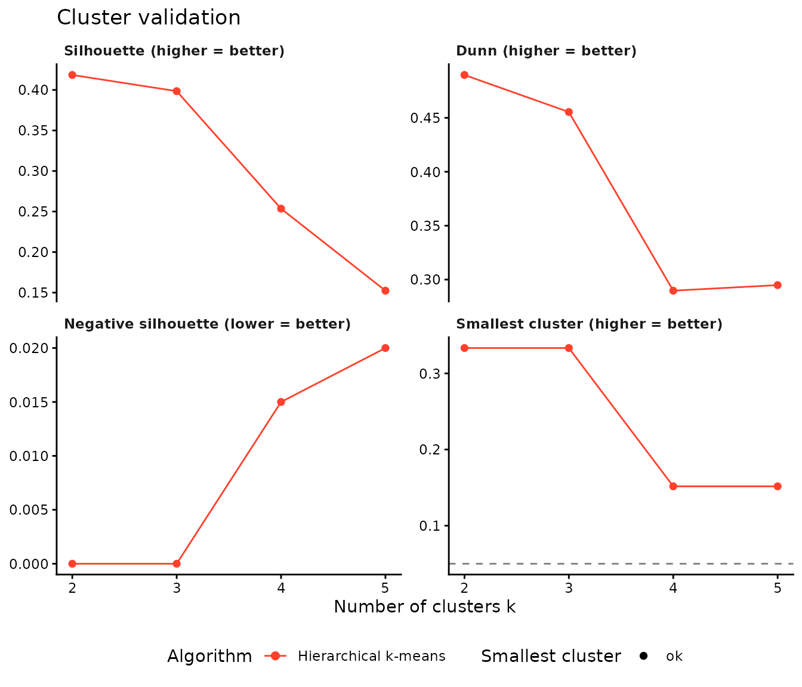

The plot shows each measure over the number of clusters, together with
the share of the smallest cluster. The silhouette coefficient is about
0.4 for *k* = 2 and 3 (a “weak” structure according to Kaufman and
Rousseeuw, although the segments are perfectly recovered; see the remark
on many variables above) and drops sharply for *k* = 4 and 5. No
respondent has a negative silhouette for *k* = 2 and 3.

The **silhouette plot** shows the silhouette width of each respondent,
sorted by cluster. The dashed line is the silhouette coefficient. Good
clusters have long bars that are similar within the cluster and no
negative bars:

``` r

val_sim$plots$silhouette$`Hierarchical k-means, k = 3`
```

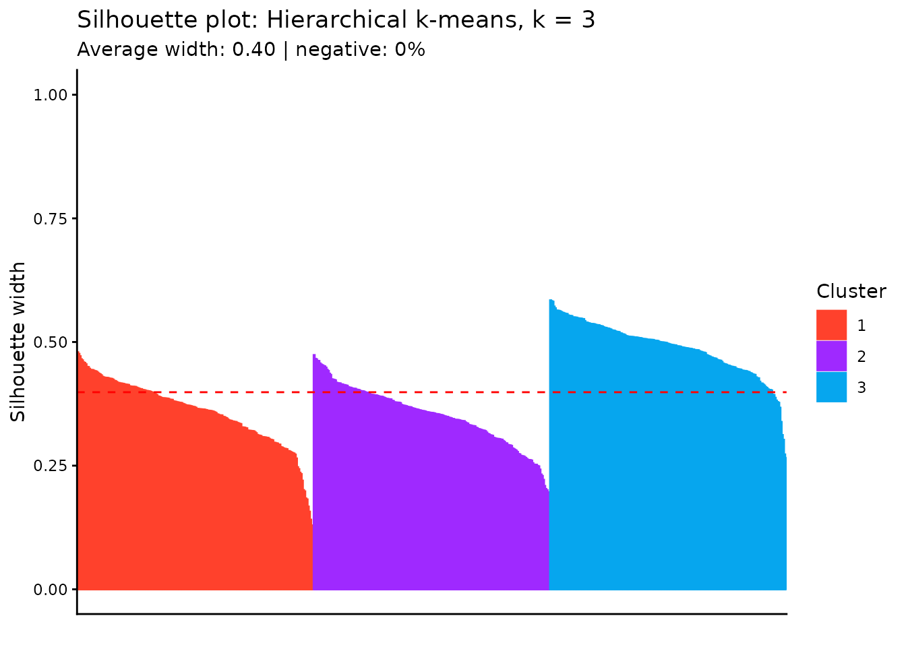

The silhouette plot of *k* = 4 shows what happens when there are more
clusters than segments: one true segment is split into two clusters with
silhouette widths close to 0.

``` r

val_sim$plots$silhouette$`Hierarchical k-means, k = 4`
```

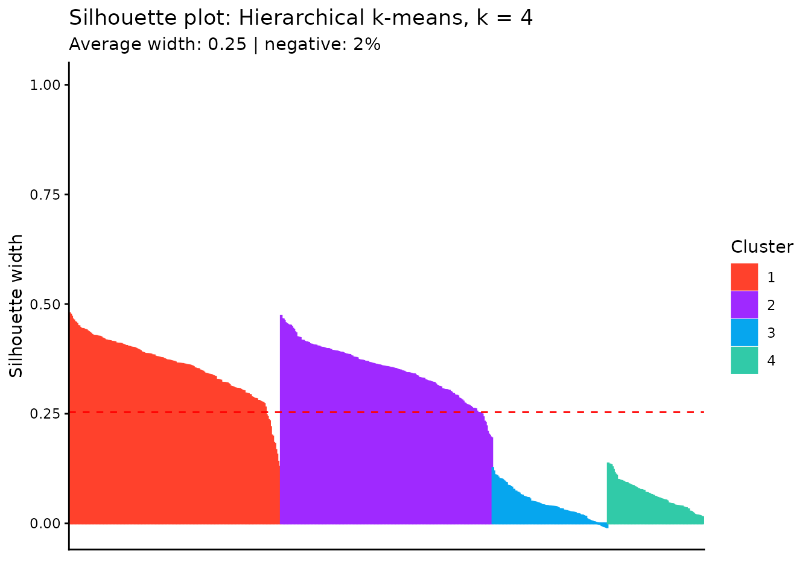

``` r

val_sim$cluster_silhouette |> filter(solution == "Hierarchical k-means, k = 4")
#> # A tibble: 4 × 5
#>   solution                    cluster     n avg_width negative_share
#>   <chr>                         <int> <int>     <dbl>          <dbl>
#> 1 Hierarchical k-means, k = 4       1   200    0.358          0     
#> 2 Hierarchical k-means, k = 4       2   200    0.350          0     
#> 3 Hierarchical k-means, k = 4       3   109    0.0438         0.0826
#> 4 Hierarchical k-means, k = 4       4    91    0.0636         0
```

### Example with real survey data: `sm_synthetic`

``` r

val <- seg_validation(cl)
#> 
#> ── Cluster validation ──
#> 
#> 1 solution | distance: "euclidean"
#> • Hierarchical k-means, k = 4: silhouette = 0.09, Dunn = 0.092, negative
#> silhouette = 8%, smallest cluster = 19%
#> ℹ Highest silhouette coefficient 0.09: no substantial cluster structure (Kaufman & Rousseeuw).
#> Plots: `$plot (measures)`, `$plot_silhouette`, and `$plots`
val$cluster_silhouette
#> # A tibble: 4 × 5
#>   solution                    cluster     n avg_width negative_share
#>   <chr>                         <int> <int>     <dbl>          <dbl>
#> 1 Hierarchical k-means, k = 4       1   411    0.0676        0.0681 
#> 2 Hierarchical k-means, k = 4       2   367    0.133         0.00545
#> 3 Hierarchical k-means, k = 4       3   362    0.117         0      
#> 4 Hierarchical k-means, k = 4       4   260    0.0438        0.323
```

``` r

val$plots$silhouette[[1]]
```

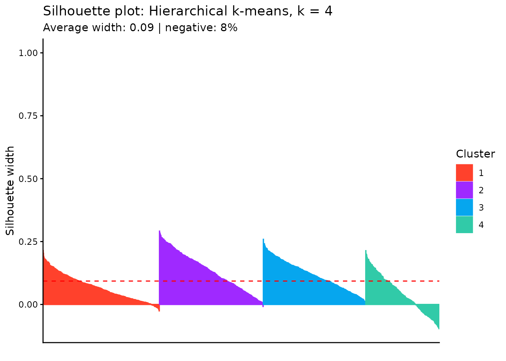

The silhouette coefficient of 0.09 confirms the impression from the
clustering tendency: there is no substantial cluster structure in the
sense of Kaufman and Rousseeuw. 8% of the respondents have a negative
silhouette width. The table per cluster shows that the clusters differ
in quality: cluster 4 has the lowest average silhouette width and the
largest share of negative silhouette widths, i.e. many of its members
are close to another cluster. To find out to which cluster these
respondents are close, look at the `neighbor` column in
`val$silhouette`:

``` r

val$silhouette[[1]] |>
  filter(sil_width < 0) |>
  count(cluster, neighbor)
#> # A tibble: 5 × 3
#>   cluster neighbor     n
#>     <int>    <int> <int>
#> 1       1        2     6
#> 2       1        3    22
#> 3       2        3     2
#> 4       4        1    18
#> 5       4        3    66
```

To compare the candidate solutions, validate all of them together:

``` r

cl_set <- seg_cluster(prep, k = 2:6, plots = FALSE, verbose = FALSE)
val_set <- seg_validation(cl_set, external = "cluster_benchmark", silhouette_plots = FALSE)
#> 
#> ── Cluster validation ──
#> 
#> 5 solutions | distance: "euclidean" | external grouping: "cluster_benchmark"
#> • Hierarchical k-means, k = 2: silhouette = 0.17, Dunn = 0.120, negative
#> silhouette = 5%, smallest cluster = 44% | corrected Rand = 0.28, VI = 1.29
#> • Hierarchical k-means, k = 3: silhouette = 0.10, Dunn = 0.159, negative
#> silhouette = 8%, smallest cluster = 26% | corrected Rand = 0.46, VI = 1.17
#> • Hierarchical k-means, k = 4: silhouette = 0.09, Dunn = 0.092, negative
#> silhouette = 8%, smallest cluster = 19% | corrected Rand = 0.66, VI = 1.02
#> • Hierarchical k-means, k = 5: silhouette = 0.08, Dunn = 0.059, negative
#> silhouette = 10%, smallest cluster = 18% | corrected Rand = 0.51, VI = 1.34
#> • Hierarchical k-means, k = 6: silhouette = 0.07, Dunn = 0.092, negative
#> silhouette = 10%, smallest cluster = 10% | corrected Rand = 0.46, VI = 1.50
#> 
#> Best solution per measure
#> • Silhouette (higher = better): Hierarchical k-means, k = 2 (0.169)
#> • Dunn (higher = better): Hierarchical k-means, k = 3 (0.159)
#> • Negative silhouette (lower = better): Hierarchical k-means, k = 2 (0.046)
#> • Corrected Rand (higher = better): Hierarchical k-means, k = 4 (0.657)
#> • VI (lower = better): Hierarchical k-means, k = 4 (1.025)
#> ℹ Highest silhouette coefficient 0.17: no substantial cluster structure (Kaufman & Rousseeuw).
#> Plots: `$plot (measures)` and `$plots`
val_set$summary
#> # A tibble: 5 × 11
#>   method                  k solution     n silhouette   dunn negative_silhouette
#>   <fct>               <int> <chr>    <int>      <dbl>  <dbl>               <dbl>
#> 1 Hierarchical k-mea…     2 Hierarc…  1400     0.169  0.120               0.0457
#> 2 Hierarchical k-mea…     3 Hierarc…  1400     0.100  0.159               0.085 
#> 3 Hierarchical k-mea…     4 Hierarc…  1400     0.0931 0.0917              0.0814
#> 4 Hierarchical k-mea…     5 Hierarc…  1400     0.0764 0.0590              0.104 
#> 5 Hierarchical k-mea…     6 Hierarc…  1400     0.0744 0.0917              0.0993
#> # ℹ 4 more variables: smallest_share <dbl>, too_small <lgl>,
#> #   corrected_rand <dbl>, vi <dbl>
val_set$plot
```

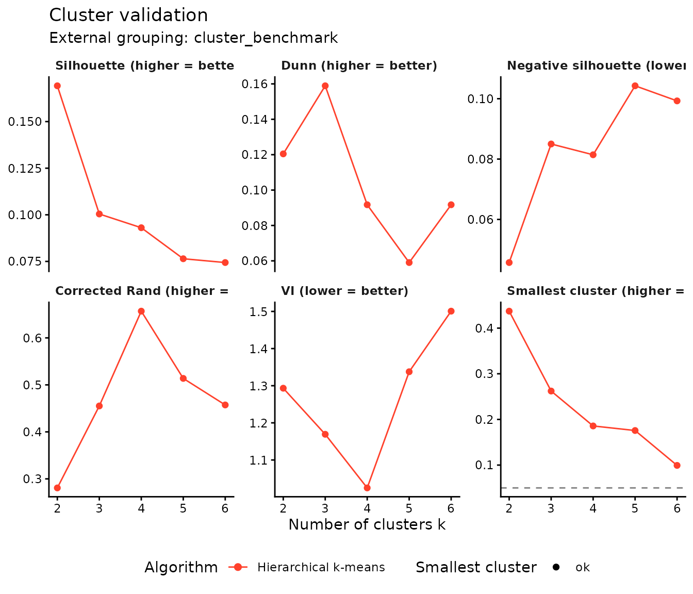

The internal measures favour *k* = 2 (highest silhouette coefficient,
fewest negative silhouette widths) and *k* = 3 (highest Dunn index). As
discussed in Section 3, this is typical for survey data and does not
automatically make *k* = 2 the best segmentation; the internal measures
should be weighed against interpretability and usefulness. With a weak
structure, also check the **stability** of the chosen solution,
e.g. whether it is similar with another algorithm
(`seg_cluster(prep, method = "pam", k = 4)`) or with another imputation
method, using the external measures below.

### External validation

If a reference grouping is known, `seg_validation(external = ...)`
measures how well each solution agrees with it. The reference can be a
column of the original data (as `"cluster_benchmark"` above), a vector,
or another cluster solution. The number of groups does not need to be
the same.

- **Corrected Rand index** (Hubert & Arabie, 1985; also *adjusted Rand
  index*, ARI): considers all pairs of respondents and counts how often
  both groupings agree (both in the same group, or both in different
  groups), corrected for the agreement expected by chance. 1 = identical
  groupings, 0 = agreement at chance level. Steinley (2004) suggests: \>
  0.90 excellent, \> 0.80 good, \> 0.65 moderate, and ≤ 0.65 poor
  agreement.
- **Meila’s variation of information** (VI; Meila, 2007): an
  information-theoretic distance between the two groupings. 0 =
  identical groupings, higher values = less agreement. VI has no general
  thresholds and is used to compare solutions.

In `sim_segments`, the true segments are known:

``` r

val_sim_ext <- seg_validation(cl_sim_set, external = "segment", silhouette_plots = FALSE)
#> 
#> ── Cluster validation ──
#> 
#> 4 solutions | distance: "euclidean" | external grouping: "segment"
#> • Hierarchical k-means, k = 2: silhouette = 0.42, Dunn = 0.490, negative
#> silhouette = 0%, smallest cluster = 33% | corrected Rand = 0.57, VI = 0.46
#> • Hierarchical k-means, k = 3: silhouette = 0.40, Dunn = 0.455, negative
#> silhouette = 0%, smallest cluster = 33% | corrected Rand = 1.00, VI = 0.00
#> • Hierarchical k-means, k = 4: silhouette = 0.25, Dunn = 0.290, negative
#> silhouette = 2%, smallest cluster = 15% | corrected Rand = 0.87, VI = 0.23
#> • Hierarchical k-means, k = 5: silhouette = 0.15, Dunn = 0.295, negative
#> silhouette = 2%, smallest cluster = 15% | corrected Rand = 0.73, VI = 0.46
#> 
#> Best solution per measure
#> • Silhouette (higher = better): Hierarchical k-means, k = 2 (0.418)
#> • Dunn (higher = better): Hierarchical k-means, k = 2 (0.490)
#> • Negative silhouette (lower = better): Hierarchical k-means, k = 2 (0.000)
#> • Corrected Rand (higher = better): Hierarchical k-means, k = 3 (1.000)
#> • VI (lower = better): Hierarchical k-means, k = 3 (0.000)
#> ℹ Highest silhouette coefficient 0.42: weak cluster structure (Kaufman & Rousseeuw).
#> Plots: `$plot (measures)` and `$plots`
val_sim_ext$summary |> select(solution, silhouette, corrected_rand, vi)
#> # A tibble: 4 × 4
#>   solution                    silhouette corrected_rand    vi
#>   <chr>                            <dbl>          <dbl> <dbl>
#> 1 Hierarchical k-means, k = 2      0.418          0.571 0.462
#> 2 Hierarchical k-means, k = 3      0.399          1     0    
#> 3 Hierarchical k-means, k = 4      0.254          0.870 0.230
#> 4 Hierarchical k-means, k = 5      0.152          0.728 0.460
```

The solution with *k* = 3 agrees perfectly with the true segments
(corrected Rand index = 1, VI = 0). Note that *k* = 2 has a slightly
higher silhouette coefficient but only a moderate agreement with the
truth: the external validation confirms the elbow, the gap statistic and
NbClust.

For `sm_synthetic`, the summary above (`val_set$summary`) shows that *k*
= 4 agrees best with the four nutrition types of the original study,
with a corrected Rand index of 0.66 (moderate agreement according to
Steinley, 2004). The cross tabulation shows which new cluster
corresponds to which original segment:

``` r

val_set$crosstabs$`Hierarchical k-means, k = 4`
#>            cluster_benchmark
#> Cluster     Ausgewogener Omnivore Nachhaltig-Ökologischer Geniesser Pragmatiker
#>   Cluster 1                   339                                25          33
#>   Cluster 2                    31                               333           3
#>   Cluster 3                    35                                12         302
#>   Cluster 4                     4                                 0          27
#>            cluster_benchmark
#> Cluster     Preisbewusster Carnivore
#>   Cluster 1                       14
#>   Cluster 2                        0
#>   Cluster 3                       13
#>   Cluster 4                      229
```

Note that external validation is only possible if a meaningful reference
grouping exists. A deviation from an earlier segmentation is not
necessarily a flaw, e.g. if the clustering variables or the population
have changed.

### Agreement between algorithms

A robust segmentation should not depend too much on the choice of the
algorithm: if different algorithms with the same number of clusters
assign most respondents to the same clusters, the segments are more
likely to reflect a real structure.
[`seg_agreement()`](https://eguizarrosales.github.io/YouAnalyser/reference/seg_agreement.md)
compares several solutions computed on the same prepared data. As
cluster numbers are arbitrary, it first matches the clusters of each
solution to those of a reference (the first solution), so that “cluster
2” stands for the same group of respondents in all solutions. For each
pair of solutions, it reports the **share of respondents in matched
clusters** (agreement), the corrected Rand index and VI:

``` r

agr <- seg_agreement(list(
  `Hierarchical k-means` = cl,
  PAM = seg_cluster(prep, "pam", k = 4, plots = FALSE, verbose = FALSE),
  Ward = seg_cluster(prep, "agnes", k = 4, plots = FALSE, verbose = FALSE)
))
#> 
#> ── Agreement of 3 cluster solutions ──
#> 
#> 1400 respondents | reference: "Hierarchical k-means"
#> • Hierarchical k-means vs. PAM: 70% agreement, corrected Rand = 0.41, VI = 1.29
#> • Hierarchical k-means vs. Ward: 68% agreement, corrected Rand = 0.33, VI =
#> 1.41
#> • PAM vs. Ward: 66% agreement, corrected Rand = 0.33, VI = 1.53
#> Same cluster in all solutions: 53% of the respondents
#> Results: `$pairwise`, `$respondents`, `$aligned`, `$crosstabs`, `$plot`
```

``` r

agr$plot
```

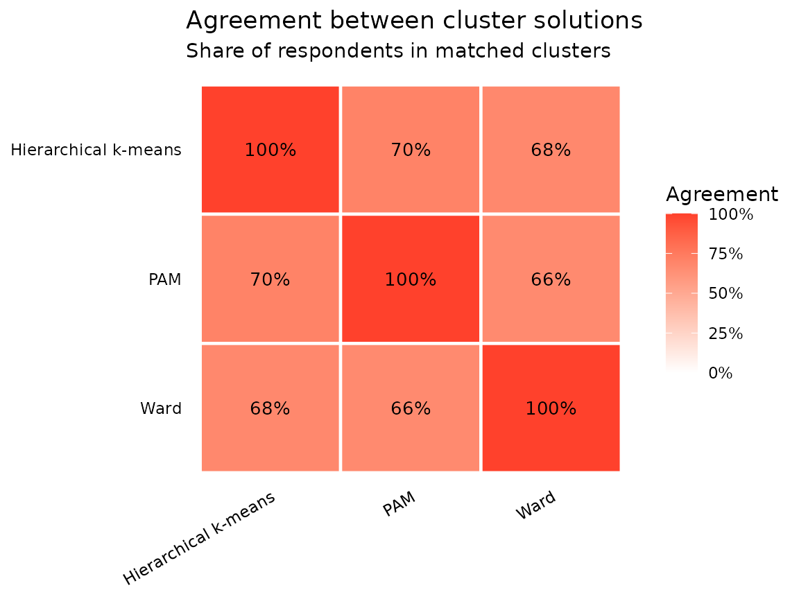

`agr$crosstabs` contains the cross tables of the matched clusters with
the reference, `agr$respondents` the matched cluster of each respondent
in each solution (e.g. to identify respondents who switch between
clusters), and `agr$aligned` the renumbered solutions, whose cluster
centres and profiles can be compared directly. On weakly structured data
such as `sm_synthetic`, a substantial share of respondents typically
switches between neighbouring clusters, which is another sign that the
segments are tendencies rather than clearly separated groups.

## 6. Cluster interpretation

The last step is to understand and name the clusters: *what
characterizes the respondents of each cluster, and how do they differ
from the others?* This is done by comparing the clusters on

- the **clustering variables**, which define the clusters and are the
  basis for naming them, and
- **profiling variables** that were not used for clustering,
  e.g. sociodemographics, behaviour or brand KPIs, which show who the
  clusters are and how to reach them.

### Cluster profiles

A first overview of the clustering variables is given by the **cluster
profiles**, which every solution includes as `plots$centers`. They show
the cluster centres (`cl$centers`), i.e. the mean of each clustering
variable per cluster, with the total mean as dashed line:

``` r

cl$plots$centers
```

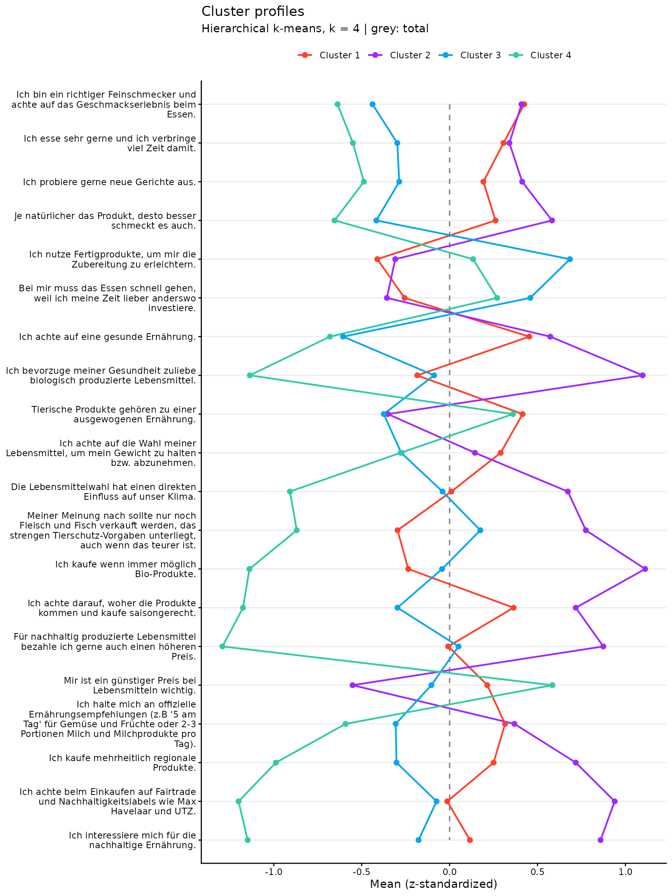

As the variables are z-standardized, the centres are expressed in
standard deviations from the overall mean: a value of 0.5 means that the
cluster scores half a standard deviation above the average. Following
Cohen (1988), deviations of about 0.2, 0.5 and 0.8 can be regarded as
small, medium and large. Compared to the profiles of `sim_segments`
(Section 4), the clusters differ less and on more variables at once, but
some clear patterns emerge, e.g. cluster 2 agrees more and cluster 4
less than average with most statements on sustainability and organic
food.

To name the clusters, it helps to look at each cluster separately and to
sort the variables by how much the clusters differ, so that the most
distinctive variables come first.
[`seg_plot_centers()`](https://eguizarrosales.github.io/YouAnalyser/reference/seg_plot_centers.md)
re-creates the plot with other settings:

``` r

seg_plot_centers(cl, type = "bars", order = "difference")
```

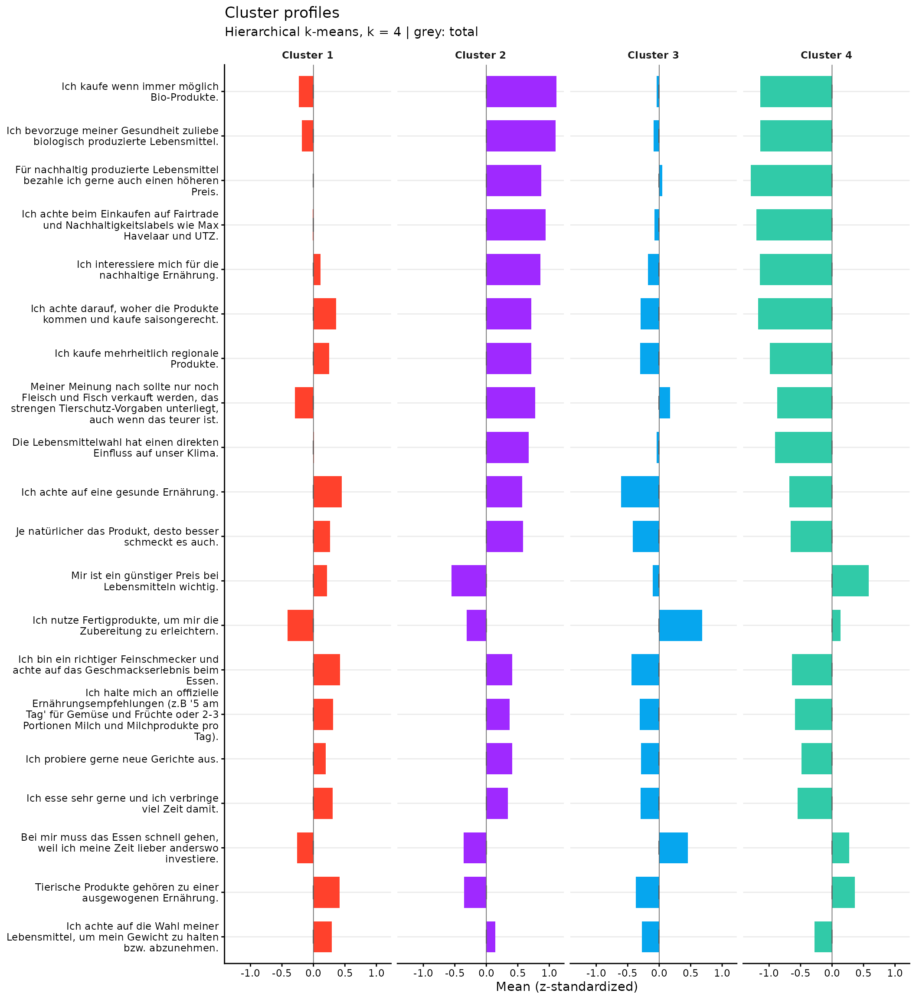

For reports, the means on the original answer scale (here 1-10) are
often easier to communicate. The heatmap shows them as numbers, coloured
by the difference to the total mean:

``` r

seg_plot_centers(cl, type = "heatmap", scale = "original")
```

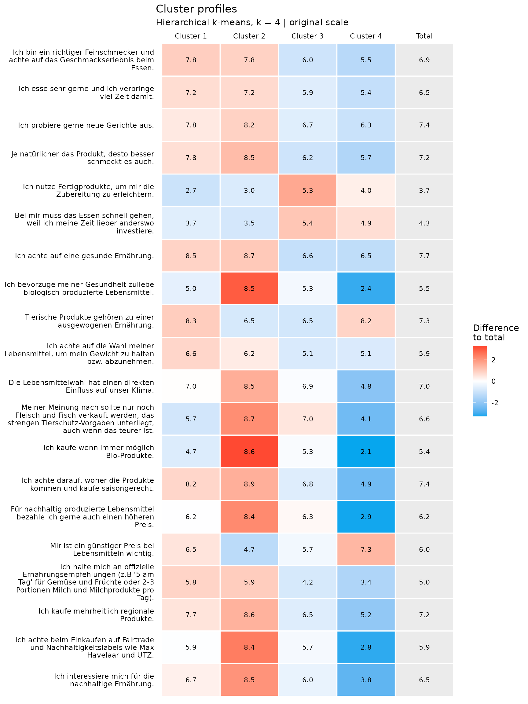

The cluster profiles are a quick overview of the clustering variables.
They do not show whether the differences are statistically significant,
do not use survey weights and do not cover profiling variables. This is
what the `eda_` functions are for.

### Detailed comparison with `eda_explore()` and the `eda_` functions

The **easiest way to compare clusters in detail is
[`eda_explore()`](https://eguizarrosales.github.io/YouAnalyser/reference/eda_explore.md)**,
an interactive app (Shiny gadget) that opens in the viewer pane. Pass it
a cluster solution, and every solution is available as a grouping
variable (e.g. `cluster_k4`), together with all variables of the
original data:

``` r

eda_explore(cl) # a single solution
eda_explore(cl_set) # several solutions: compare cluster_k2 to cluster_k6
```

In the app, you can select variables by name or label (e.g. a whole item
battery), a grouping variable and a weight, and get:

- plots of the means or distributions per cluster, with markers for
  clusters that are significantly higher or lower than the total,
- descriptive statistics per cluster and tests of the differences
  between clusters,
- a detailed plot of a single variable with statistical tests,
- the R code to reproduce all results in a script.

The same functionality is available as functions for use in scripts and
reports, all of which accept a cluster solution as `data`:

- [`eda_plot()`](https://eguizarrosales.github.io/YouAnalyser/reference/eda_plot.md):
  plots of several variables by cluster,
- [`eda_describe()`](https://eguizarrosales.github.io/YouAnalyser/reference/eda_describe.md):
  descriptive statistics by cluster (means, confidence intervals,
  distributions),
- [`eda_test()`](https://eguizarrosales.github.io/YouAnalyser/reference/eda_test.md):
  tests of the differences between the clusters,
- [`eda_plot_detail()`](https://eguizarrosales.github.io/YouAnalyser/reference/eda_plot_detail.md):
  detailed plot of a single variable with statistical tests.

For example, the profile of the four clusters on the clustering
variables, with triangles marking clusters that are significantly above
or below the total:

``` r

eda_plot(
  cl,
  vars = starts_with("F50_0_"),
  group = "cluster_k4",
  show_sig = TRUE,
  label_width = 45
)
```

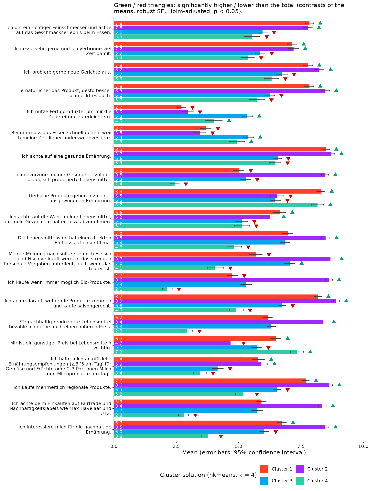

Reading such a plot item by item quickly leads to a description of each
cluster. For example, cluster 2 agrees most with all statements about
sustainability, organic food and animal welfare, whereas cluster 4
agrees least with them, but strongly with “Tierische Produkte gehören zu
einer ausgewogenen Ernährung”, and attaches the most importance to low
prices. Such patterns are the basis for naming the segments (here, they
closely resemble the “Nachhaltig-Ökologischer Geniesser” and the
“Preisbewusster Carnivore” of the original study).

And a description of the clusters by sociodemographics, weighted with
the survey weight:

``` r

eda_describe(
  cl,
  vars = c("gender", "age_group", "region", "education"),
  group = "cluster_k4",
  weight = "weight",
  total = TRUE,
  test = TRUE
)
```

Note that the clustering itself is unweighted (each respondent counts
once when defining the segments), while the description of the segments
can and usually should use the survey weights.

## 7. Assigning new respondents

Once a segmentation is established, it is often applied to **new
respondents**: a new survey wave, a booster sample or a short screener
in a later study. Re-running the cluster analysis on the new data would
produce new clusters that are not comparable to the original ones.
Instead, [`predict()`](https://rdrr.io/r/stats/predict.html) assigns the
new respondents to the existing clusters.

The new data only needs to contain the original clustering variables
(the same columns as the data passed to
[`seg_prep_data()`](https://eguizarrosales.github.io/YouAnalyser/reference/seg_prep_data.md)).
It is prepared exactly like the original sample. Missing values are
handled with the same strategy, and the variables are rescaled with the
means and standard deviations of the **original** sample, so that new
respondents are compared with the original clusters on the same scale.
Each method then assigns the respondents in the way that is consistent
with how it formed the clusters, e.g. to the nearest cluster centre for
(hierarchical) k-means (see
[`?predict.seg_cluster`](https://eguizarrosales.github.io/YouAnalyser/reference/predict.seg_cluster.md)).

For illustration, we treat the first 200 respondents of `sm_synthetic`
as a new wave:

``` r

new_wave <- sm_synthetic |> slice(1:200)
pred <- predict(cl, new_wave)
pred
#> # A tibble: 200 × 3
#>       id cluster distance
#>    <dbl>   <int>    <dbl>
#>  1     1       1     4.60
#>  2     2       1     3.29
#>  3     3       4     4.85
#>  4     4       3     3.69
#>  5     5       3     2.89
#>  6     6       3     3.77
#>  7     7       2     5.06
#>  8     8       4     3.94
#>  9     9       1     2.77
#> 10    10       3     4.39
#> # ℹ 190 more rows
```

The result contains one row per new respondent, in the same order: the
identifier, the assigned `cluster` and the `distance` to the centre of
that cluster. Respondents who cannot be assigned (e.g. because they
answered none of the clustering variables) get `cluster = NA`.
Respondents with an unusually large distance fit none of the clusters
well and may deserve a closer look.

As these respondents were part of the original sample, their predicted
clusters agree with the original assignment:

``` r

pred |>
  left_join(cl$assignment, by = "id", suffix = c("_predicted", "_original")) |>
  count(cluster_predicted, cluster_original)
#> # A tibble: 4 × 3
#>   cluster_predicted cluster_original     n
#>               <int>            <int> <int>
#> 1                 1                1    62
#> 2                 2                2    45
#> 3                 3                3    60
#> 4                 4                4    33
```

For fuzzy and model-based clustering, `type = "prob"` also returns the
membership probabilities of each respondent, which show how clearly a
respondent belongs to their cluster. For all methods, `rule = "knn"`
assigns respondents by a majority vote of their nearest neighbours in
the original sample, with the share of votes per cluster as
probabilities:

``` r

predict(cl, new_wave, rule = "knn", type = "prob")
#> # A tibble: 200 × 7
#>       id cluster knn_share prob_cluster_1 prob_cluster_2 prob_cluster_3
#>    <dbl>   <int>     <dbl>          <dbl>          <dbl>          <dbl>
#>  1     1       1       0.6            0.6            0.4            0  
#>  2     2       1       0.6            0.6            0.1            0.3
#>  3     3       4       0.7            0              0              0.3
#>  4     4       3       0.8            0              0.2            0.8
#>  5     5       1       0.6            0.6            0.1            0.3
#>  6     6       3       1              0              0              1  
#>  7     7       2       0.9            0.1            0.9            0  
#>  8     8       4       0.5            0.3            0              0.2
#>  9     9       1       0.9            0.9            0              0.1
#> 10    10       3       1              0              0              1  
#> # ℹ 190 more rows
#> # ℹ 1 more variable: prob_cluster_4 <dbl>
```

## References

Bezdek, J. C., & Hathaway, R. J. (2002). VAT: A tool for visual
assessment of (cluster) tendency. *Proceedings of the 2002 International
Joint Conference on Neural Networks*, 2225-2230.
<https://doi.org/10.1109/IJCNN.2002.1007487>

Brock, G., Pihur, V., Datta, S., & Datta, S. (2008). clValid: An R
package for cluster validation. *Journal of Statistical Software,
25*(4), 1-22. <https://doi.org/10.18637/jss.v025.i04>

Charrad, M., Ghazzali, N., Boiteau, V., & Niknafs, A. (2014). NbClust:
An R package for determining the relevant number of clusters in a data
set. *Journal of Statistical Software, 61*(6), 1-36.
<https://doi.org/10.18637/jss.v061.i06>

Cohen, J. (1988). *Statistical power analysis for the behavioral
sciences* (2nd ed.). Lawrence Erlbaum.

Dolnicar, S., Grün, B., & Leisch, F. (2018). *Market segmentation
analysis: Understanding it, doing it, and making it useful*. Springer.
<https://doi.org/10.1007/978-981-10-8818-6>

Dunn, J. C. (1974). Well-separated clusters and optimal fuzzy
partitions. *Journal of Cybernetics, 4*(1), 95-104.
<https://doi.org/10.1080/01969727408546059>

Hartigan, J. A., & Wong, M. A. (1979). Algorithm AS 136: A k-means
clustering algorithm. *Journal of the Royal Statistical Society: Series
C, 28*(1), 100-108. <https://doi.org/10.2307/2346830>

Hopkins, B., & Skellam, J. G. (1954). A new method for determining the
type of distribution of plant individuals. *Annals of Botany, 18*(2),
213-227. <https://doi.org/10.1093/oxfordjournals.aob.a083391>

Hubert, L., & Arabie, P. (1985). Comparing partitions. *Journal of
Classification, 2*, 193-218. <https://doi.org/10.1007/BF01908075>

Kassambara, A. (2017). *Practical guide to cluster analysis in R:
Unsupervised machine learning*. STHDA. See also
<https://www.datanovia.com/learn/machine-learning/clustering>

Kaufman, L., & Rousseeuw, P. J. (1990). *Finding groups in data: An
introduction to cluster analysis*. Wiley.
<https://doi.org/10.1002/9780470316801>

Lawson, R. G., & Jurs, P. C. (1990). New index for clustering tendency
and its application to chemical problems. *Journal of Chemical
Information and Computer Sciences, 30*(1), 36-41.
<https://doi.org/10.1021/ci00065a010>

MacQueen, J. (1967). Some methods for classification and analysis of
multivariate observations. *Proceedings of the Fifth Berkeley Symposium
on Mathematical Statistics and Probability, 1*, 281-297.

Meila, M. (2007). Comparing clusterings - an information based distance.
*Journal of Multivariate Analysis, 98*(5), 873-895.
<https://doi.org/10.1016/j.jmva.2006.11.013>

Rousseeuw, P. J. (1987). Silhouettes: A graphical aid to the
interpretation and validation of cluster analysis. *Journal of
Computational and Applied Mathematics, 20*, 53-65.
<https://doi.org/10.1016/0377-0427(87)90125-7>

Schafer, J. L. (1999). Multiple imputation: A primer. *Statistical
Methods in Medical Research, 8*(1), 3-15.
<https://doi.org/10.1177/096228029900800102>

Steinley, D. (2004). Properties of the Hubert-Arabie adjusted Rand
index. *Psychological Methods, 9*(3), 386-396.
<https://doi.org/10.1037/1082-989X.9.3.386>

Thorndike, R. L. (1953). Who belongs in the family? *Psychometrika,
18*(4), 267-276. <https://doi.org/10.1007/BF02289263>

Tibshirani, R., Walther, G., & Hastie, T. (2001). Estimating the number
of clusters in a data set via the gap statistic. *Journal of the Royal
Statistical Society: Series B, 63*(2), 411-423.
<https://doi.org/10.1111/1467-9868.00293>

Ward, J. H. (1963). Hierarchical grouping to optimize an objective
function. *Journal of the American Statistical Association, 58*(301),
236-244. <https://doi.org/10.1080/01621459.1963.10500845>

Wright, K. (2022). Will the real Hopkins statistic please stand up? *The
R Journal, 14*(3), 282-292. <https://doi.org/10.32614/RJ-2022-055>
